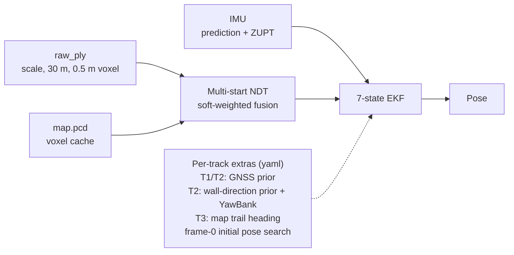

# SDC 2026 Midterm01 – Image-based Localization on a LiDAR Map

Causal localization from LoGeR point clouds (`raw_ply`) against a pre-built LiDAR map (`map.pcd`). One ROS 2 package (`localization`), one parameter file per track.

## Method in brief



- **Causal only**: frame *k* uses data up to frame *k*. No smoothing or post-processing.
- **GNSS** is used on Track1/2 only (Track3 has none).

## Layout

```
Dockerfile, docker-compose.yml     # ROS 2 Jazzy environment (container: mid1_container)
midterm01/                         # colcon workspace (mounted at /root/midterm)
├── README.md
├── STATUS.md                      # progress log, experiments, failed attempts
├── report/                        # report draft
└── src/localization/
    ├── CMakeLists.txt, package.xml
    ├── config/localization_params_Track{1,2,3}.yaml   # one full parameter file per track
    ├── launch/{localization,map_modified,visualization}.launch.py
    ├── include/localization/*.h, src/*.cpp
    ├── processing_codes/txt_to_idx_x_y_yaw.py          # result.txt -> Kaggle csv
    ├── tools/                     # evaluation helpers
    └── result/                    # Track{1,2,3}_result.txt, result_{1,2,3}.csv (final submission)
```

## Usage

Place the datasets in `data/Track{1,2,3}/` (mounted as `/root/data`).

**1. Build** (inside the container)

```bash
docker compose up -d && docker exec -it mid1_container bash
cd /root/midterm
colcon build --packages-select localization --cmake-args -DCMAKE_BUILD_TYPE=Release
source install/setup.bash
```

**2. Map cache** (once per track, one at a time; the ASCII map is ~2.7 GB)

```bash
ros2 launch localization map_modified.launch.py data_path:=/root/data/Track1 voxel_leaf_size:=1.0
```

**3. Localize** (the yaml is chosen from the `data_path` directory name; no overrides needed)

```bash
ros2 launch localization localization.launch.py data_path:=/root/data/Track1 save_file:=Track1_result.txt
```

Output: one line per PLY frame (first 3 rows of `T_map_body`). Optional argument `max_frames:=N` runs only the first N frames.

**4. Kaggle csv**

```bash
python3 src/localization/processing_codes/txt_to_idx_x_y_yaw.py \
    src/localization/result/Track1_result.txt src/localization/result/result_1.csv
```

Repeat with `Track2`/`Track3` for the other tracks. Submitted files: `result_1.csv`, `result_2.csv`, `result_3.csv`.

**Visualize / evaluate** (optional; GNSS evaluation is Track1/2 only)

```bash
ros2 launch localization visualization.launch.py data_path:=/root/data/Track1
python3 src/localization/tools/extract_bag.py /root/data/Track1/Track1.db3 /root/data/Track1/ref
python3 src/localization/tools/eval_ate.py src/localization/result/Track1_result.txt \
    /root/data/Track1/raw_ply /root/data/Track1/ref/gnss.csv
```

## Per-track configuration and results

The three yaml files differ only where listed (`tools/diff_params.py` checks this).

| | Track1 | Track2 | Track3 |
|---|---|---|---|
| `ply_scale` | 8.5 | 8.7 | 7.5 |
| GNSS prior | on | on | off |
| Frame-0 pose search | yaw only | off | yaw + xy |
| Wall-direction prior, YawBank | off | on | off |
| Trail heading | off | off | on |
| `process_sigma_accel_bias` | 0.01 | 0.002 | 0.002 |
| **Kaggle public** | **1.13** | **0.77** | **1.74** |
| Baseline | 1.79 | 1.92 | 1.29 (public) / 1.40 (private) |

Score: `E = sqrt(mean‖Δp‖²) + 0.2·sqrt(mean Δθ²)` (m, degrees). Local GNSS error is circular for the GNSS-prior runs, so only Kaggle scores are comparable. Development history and ablations are in `STATUS.md`.
