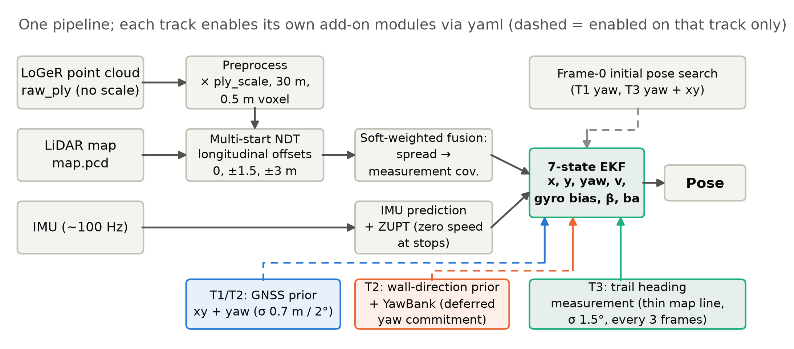
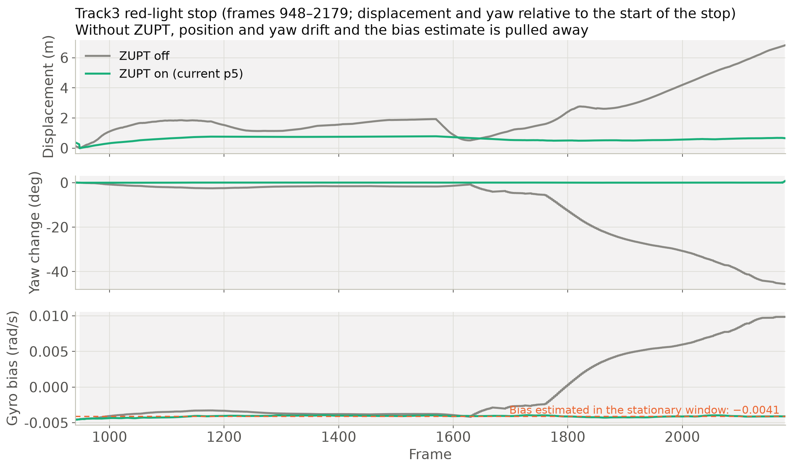
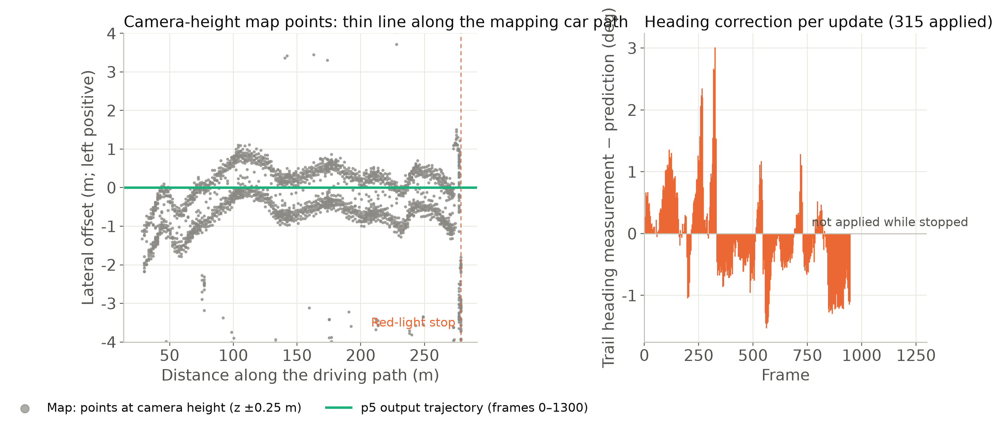
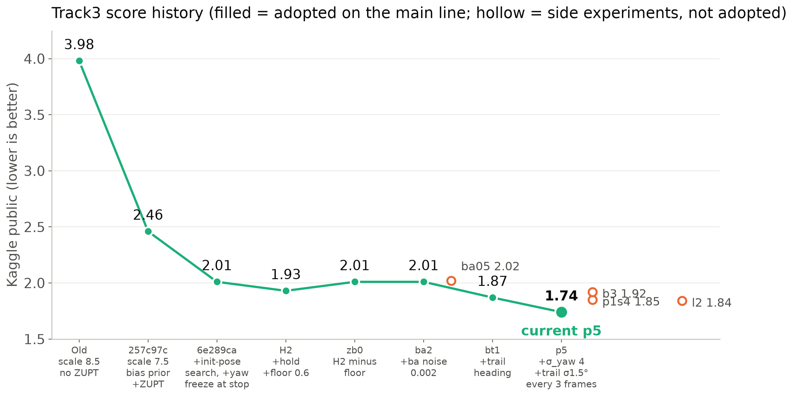

# SDC 2026 Midterm01 Localization 報告（草稿）

> **草稿狀態（11/04）**：內容取自 `STATUS.md`（§2–§5）與 `slides_figs_en/` 的現成圖；`【待補】` 為需要使用者填入或確認的項目。最終交付為 PDF：`localization_report_<學號1>_<學號2>.pdf`。
> 數字皆為 Kaggle public 分數或本地對 GNSS 的評估；Track1／2 啟用 GNSS 先驗的版本，本地對 GNSS 的 E 已循環，**只引用 Kaggle**。

- 組別： 7
- 成員：王修呈 a151527
- 程式碼與結果：`localization/`（見 README）

---

## 摘要

以 LoGeR 前鏡頭點雲（`raw_ply`）對預建 LiDAR 地圖（`map.pcd`）做 scan matching，估計每個影像幀的車輛位姿。我們沒有直接沿用範本，而是自行設計了一條 **causal** 的管線：NDT 多起點＋候選軟加權 → IMU 驅動的 7 狀態 EKF（含 ZUPT 靜止約束）→ 各 track 以 yaml 開關的外加量測（GNSS 先驗、牆面方向先驗、地圖軌跡線航向）。

| Track | 權重 r | 正式版 | Kaggle | Baseline | 結果 |
|---|---|---|---|---|---|
| Track1 | 0.3 | `gb`（GNSS xy＋yaw） | **1.13** | 1.79 | 通過 |
| Track2 | 0.3 | `g2b`（GNSS xy＋yaw） | **0.77** | 1.92 | 通過 |
| Track3 | 0.4 | `p5`（軌跡線航向） | public **1.74** / private **1.36** | public 1.29／private 1.40 | public 未達 baseline；private 通過 |

---

## 1. Pipeline：程式如何運作



*圖 1　同一條管線；各 track 用 yaml 開啟自己的外加模組（虛線＝僅該 track 啟用）。*

### 1.1 資料與問題設定

- 輸入：每幀 15k–41k 點的 PLY（x 前、y 左、z 上，**沒有絕對尺度**）、ASCII 地圖（約 57–60 M 點）、`init_guess.txt`（有雜訊）、bag 內的 IMU（約 100 Hz）；Track1／2 另有 GNSS（約 4 Hz）。
- 輸出：每幀 `T_map_body`，轉成 Kaggle 的 `idx,x,y,yaw`。
- 評分：`E = RMSE(Δp) + 0.2·RMSE(Δθ[°])`，yaw 每度約等於 0.2 m。

### 1.2 處理流程

1. **前處理**：點雲乘上各 track 的尺度（Track1／2／3 為 8.5／8.7／7.5），取 30 m 內、0.5 m 體素降採樣（抑制遠處單目深度誤差）。地圖先離線降採樣成 binary 快取（`map_modified`）。
2. **NDT 多起點**：以 EKF 預測為中心，縱向 0／±1.5／±3 m 各對齊一次（解析度 3 m）。縱向是影像點雲最差的可觀測方向（候選縱向分散中位 1.13 m）。
3. **候選軟加權融合**：以 probability 對各候選軟加權，**候選分散度直接進量測協方差 R**，讓縱向不確定時不被量測拉動。
4. **7 狀態 EKF**：x、y、yaw、v、陀螺儀零偏、行進偏角 β、加速度零偏。IMU 做 causal 預測；離群量測只放大 R、不丟棄（避免舊版「整幀被拒→速度被拉低→鎖死」的發散）。
5. **ZUPT**：靜止時釘住速度與零偏、凍結 yaw、位置不加過程雜訊、傾角不混入 NDT。
6. **各 track 外加量測**（見 §2）：GNSS 先驗、牆面方向先驗＋YawBank、地圖軌跡線航向。
7. **輸出**：每幀一行 `T_map_body`，不做任何事後處理；轉換腳本只做格式轉換。

### 1.3 規則遵守

- **Causal**：第 k 幀只用 ≤k 幀的 PLY；GNSS 只取時間戳 ≤ 影格時間的樣本，位置以濾波器速度外推到影格時間；每筆只用一次。
- **無後處理、無 leaderboard probing**：Kaggle 分數只用於比較「方法／設定」，沒有用來反推誤差再修軌跡。`l2`（軌跡線橫向推）失敗後即捨棄，沒有往「用分數擬合」的方向走。
- **GNSS**：官方文件明文允許；僅 Track1／2 使用（Track3 的 bag 沒有 GNSS）。Track2 地圖的 `tl`／`th` 欄位沒有使用。
- **可重現**：每個 track 一份完整 yaml（`config/localization_params_Track{1,2,3}.yaml`）；純 yaml 全長重跑與正式結果檔**逐位元相同**（Track1／2：`v1c`／`v2c`；Track3：`y5`）。

---

## 2. Contributions：原創想法與改進

> 評分看原創性。以下以「動機 → 做法 → 證據」寫；證據都有對應的 run 與 `STATUS.md` 章節。

### 2.1 ZUPT 與靜止鎖定（Track3 3.98 → 2.46）

Track3 在約第 900–2200 幀停紅燈。沒有 ZUPT 時，停等期間位置與 yaw 持續漂移，陀螺儀零偏被 NDT 量測拉離靜止實測值（圖 2）。



*圖 2　Track3 紅燈停等（第 948–2179 幀）：ZUPT 關（灰）位移與 yaw 持續漂移、零偏被帶走；ZUPT 開（綠）零偏穩在靜止窗口估計值 −0.0041 rad/s。*

- 做法：零速量測、陀螺儀零偏觀測與先驗（−0.004）、`zupt_freeze_yaw`（K 的 yaw 列歸零，避免位置創新經交叉協方差轉動 yaw）、`zupt_hold`。
- 證據（圖 2，第 948–2179 幀，約 1230 幀，相對停等起點；`zoff3`＝`p5` 設定加 `-p zupt_enabled:=false`，對照現行 `p5`）：

| | 末端位移 | 停等段路徑長 | yaw 變化 | 第 2179 幀陀螺零偏 |
|---|---|---|---|---|
| ZUPT 關（`zoff3`） | 6.82 m | 18.01 m | −45.6° | +0.0099 rad/s |
| ZUPT 開（`p5`） | 0.67 m | 1.84 m | +0.7° | −0.0041 rad/s |

  零偏 −0.0041 與靜止窗口估得的值一致。Track3 的 Kaggle 由 3.98 降到 2.46，但該版同時改了 `ply_scale`（8.5→7.5）與陀螺零偏先驗，不能全歸功於 ZUPT（§4-2）。

### 2.2 NDT 多起點＋候選軟加權＋分散度進 R（E 1.99 → 1.79）

單幀 argmax 會在模式間翻轉（E 3.88）。改成軟加權，並把候選分散度當不確定度放進 R，E 由 1.99 降到 1.79。調 Q／R 的「一致性校準」不如此做（E 9.49／2.00／1.91），因為 NDT 誤差在時間上相關（§4-1、§5）。

### 2.3 地圖軌跡線航向量測 `TrailHeading`（Track3 2.01 → 1.87，再到 1.74）



*圖 3　左：相機高度的地圖點沿建圖車軌跡形成細線（綠線為 `p5` 輸出）；右：每次量測相對預測的航向修正量（停等時不量測）。*

- 觀察：地圖在相機高度有一層沿行駛軌跡的細長點雲，轉彎處也吻合，Track1～3 都有。
- 做法：取位姿高度 ±0.5 m、前後 12 m、左右 3 m 的圖層點做 2D PCA 線擬合（需夠細、夠長、≥40 點、與 yaw 差 ≤12°），線方向當 yaw 量測（σ 1.5°、每 3 幀、靜止不量）。**只約束航向，不約束縱向**，所以不吃影像點雲最弱的方向。
- 離線驗證（Track1／2 對 GNSS）：線方向與車頭差中位 0.8°；「線方向＋yaw 誤差」rms 1.95°／2.10°，與 NDT yaw 誤差（2.27°／3.03°）相當，且獨立於尺度（§4-20）。
- 證據：紅燈結束的突然逆時針偏轉 +4.1°→+0.5°（§4-25）；Kaggle `ba2` 2.01 → `bt1` 1.87 → `p5` 1.74。

### 2.4 GNSS 先驗 `GnssPrior`（Track1 1.52 → 1.13、Track2 1.46 → 0.77）

- 做法：讀 bag 的 GNSS，位置以濾波器速度／航向外推到影格時間，σ＝√(σxy²＋(0.3·v·age)²)，σxy 0.7 m、σyaw 2°；每筆用一次（causal）；預設關閉、逐 track 以 yaml 啟用。
- 消融（Kaggle public）：

| | 無 GNSS | 只 xy | 只 yaw | xy＋yaw |
|---|---|---|---|---|
| Track1 | 1.52 | 1.17 | 1.47 | **1.13** |
| Track2 | 1.46 | 0.78 | 1.38 | **0.77** |

  位置資訊貢獻大部分改善；yaw 單獨用幫助小，但對 Track2 靜止起步的 yaw 有效（前 300 幀 yaw 平均被拉約 5°）。

### 2.5 Track2：收斂版（發散 → 本地 E 2.27 → Kaggle 1.46）

Track2 以穩定 0.33 m/s² 起步，被誤判為靜止，真實加速度被當成零偏，速度損失使全長發散（E 218–670）。

- ZUPT 加「窗口加速度均值要接近 `ba`」條件，並在靜止時對 `ba` 做偽量測。
- **YawBank**：車速 >1 m/s 後以 9 個 yaw 偏移各跑一份濾波器，150 幀後以 fitness 承諾（E 200→2.27）。
- 釘住行進偏角 β、ply_scale 8.7。
- **牆面方向先驗 `RoadHeadingPrior`**：第 0 幀以地圖牆面主方向（點密度影像的梯度方向直方圖主峰，180° 模糊由 init_guess 解）修正靜止起步的 yaw，差 >25° 放棄。Track2 E 2.277→1.751（yaw rms 4.57→2.91°）。Track2 的 yaw 誤差幾乎全在第 0–300 幀，因果性不允許事後修正，所以起步 yaw 必須先好。

### 2.6 其他採用的設計

- **第 0 幀初始位姿搜尋**：以 init 與 IMU 姿態 yaw 為中心 ±30°／5° 搜尋，NDT probability 選最佳；Track3 init yaw 偏約 21.5°，Kaggle 2.46→2.01。Track1 只搜 yaw（xy 偏移格會把起點移偏，前 300 幀對 GNSS rms 1.49→2.16）。
- **加速度零偏過程雜訊 0.01→0.002**（Track2／3）：NDT 縱向創新不再被當成 `ba`，解決「太早轉彎」與轉彎後橫縱向偏移（使用者目視確認，§4-24）。
- **`meas_sigma_yaw_deg` 2→4**：Track1 Kaggle 1.62→1.52。

### 2.7 診斷工具（協助找出根因）

`matcher_bench`（固定位姿掃尺度／起點／`--eval_only` 對齊分數、左右分離、距離分段）、`ndt_bench.py`（單幀收斂率與準度）、`analyze_diag.py`、`decompose_yaw.py`、`pose_vs_imu_attitude.py`、`eval_ate.py`，以及隔離容器的 `run_track.sh`／`sweep.sh`／`docker_run.sh`（每個 run 輸出 manifest，差異只來自列出的 `-p` 覆寫）。

---

## 3. 結果

### 3.1 Track3 的分數演進



*圖 4　Track3 Kaggle public：實心＝主線採用、空心＝支線不採用（`ba05`、`b3`、`p1s4`、`l2`）。*

### 3.2 各 Track 版本對照（Kaggle public）

| Track | 版本 | 新增 | Kaggle |
|---|---|---|---|
| T1 | `5597dfe` | 共同基礎 | 1.56 |
| T1 | `047f72a` | ＋floor 0.6、搜 xy 格 | 1.62（退步） |
| T1 | `rhp1s4` | 只搜 yaw、σ_yaw 4 | 1.52 |
| T1 | **`gb`** | ＋GNSS xy＋yaw | **1.13** |
| T2 | `rhp2` | 收斂版＋牆面先驗、σ_yaw 4 | 1.46 |
| T2 | **`g2b`** | ＋GNSS xy＋yaw | **0.77** |
| T3 | 舊版 | scale 8.5、無 ZUPT | 3.98 |
| T3 | `257c97c` | scale 7.5＋零偏先驗＋ZUPT | 2.46 |
| T3 | `6e289ca` | ＋初始位姿搜尋＋靜止凍結 yaw | 2.01 |
| T3 | H2（`f81f508`） | ＋hold＋floor 0.6（floor 後來移除） | 1.93 |
| T3 | `bt1` | ＋`ba` 雜訊 0.002＋TrailHeading | 1.87 |
| T3 | `p1s4` | `bt1`＋σ_yaw 4 | 1.85 |
| T3 | **`p5`** | ＋σ_yaw 4＋軌跡線 σ 1.5°／每 3 幀 | **1.74**（private 1.36） |

### 3.3 本地評估的限制（誠實說明）

- GNSS 只有約 4 Hz、雜訊約 0.7 m、固定偏移約 0.5 m，分不出 0.05～0.17 的差距與逐幀抖動；本地 E 與 Kaggle 方向曾相反（Track1：1.79→1.7328，但 Kaggle 1.56→1.62）。因此同時看平滑度（位置二階差）。
- Track3 沒有真值、沒有 GNSS；public 只評約第 157–1257 幀，轉彎（約 2400–2800 幀）在 private，只能靠使用者在 rviz 目視判斷。

---

## 4. Problems and Solutions

### 4.1 縱向可觀測性差、NDT 誤差時間相關

- 問題：影像點雲縱向分散中位 1.13 m，NDT 單幀只能把誤差往真值拉約 19%；累積多幀點雲（K=4／10，E 1.94／487）、調 Q／R 都無法補救。
- 解法：速度唯一可靠來源是 IMU 加速度積分，所以投入 ZUPT 與加速度零偏；NDT 縱向創新放大 R 而非當真。

### 4.2 Track2 發散

- 問題：穩定小加速度起步被誤判為靜止（見 §2.5）。
- 解法：窗口加速度均值條件＋`ba` 偽量測、YawBank、釘住 β。

### 4.3 提高增益的 floor 補丁是死路

- 現象：Track1 逐幀抖動 2.9 倍（floor 0.6 版）；Track2 E 2.27→16.96；Track3 靜止段路徑 3.9→22.6 m。Track1 同一版（`047f72a`）另含搜 xy 格與 hold，Kaggle 1.56→1.62 退步，無法單獨歸因於 floor。
- 解法：全部關閉並移除。教訓：**本地 E 會騙人**（Track1 本地 E 1.79→1.7328 變好，Kaggle 卻變差），要同時看平滑度與 Kaggle。

### 4.4 Track3 +5° 航向殘餘（根因診斷）

使用者目視：紅燈結束後航向比 LiDAR 逆時針偏約 10°，轉彎「太早、偏左 3 m」。我們逐一檢驗假說：

| 假說 | 檢驗 | 結論 |
|---|---|---|
| 零偏學習造成 | `process_sigma_bias` 1e-4→1e-6／1e-8 | **否定**（紅燈位置 yaw 只差 0.1°） |
| 起步瞬間增益太大 | 起步後降權 yaw 量測 | **否定**（只延後，NDT 本來就要求 168～170°） |
| 尺度造成 | 尺度掃描 6.5～9.5 | 停等偏移來自尺度（`zupt_hold` 擋住是對的）；**轉彎偏移與尺度無關** |
| 點雲前傾 | 位姿與點雲地面 pitch 比較 | 行駛段位姿與點雲相符 |
| 左側結構拉偏 NDT yaw | 左右分離 NDT | **支持（推論，因果未驗證）**：紅燈位置左半 +5～6°、右半 +1～2°；左側結構在 700 幀進入視野，與 +4° 形成窗口吻合；參考為 IMU 姿態與軌跡線，皆非真值 |

- 解法（部分）：地圖軌跡線航向量測（§2.3）獨立於 NDT 與尺度，修掉紅燈結束（起步）的突然偏轉 +4.1°→+0.5°；但對 700–1000 幀已長出的殘餘只修回約 0.3～1.2°（停等時輸出−IMU 姿態 `zb0` +5.0°→`bt1` +3.8°）。再配合 σ_yaw 4 與較強的軌跡線量測（`p5`），public 區段（157–1257 幀）輸出−IMU 姿態偏差平均由 `bt1` +2.09° 降到 +1.34°。
- 未解：左右不平衡降權（`SideBalance`）、依左右選用 yaw 量測，效果正負參半，不採用。殘餘的根因本身沒有消除，只是被軌跡線量測壓低。

### 4.5 嘗試後捨棄的方向（誠實列出）

| 嘗試 | 結果 | 結論 |
|---|---|---|
| G-ICP 取代 NDT | 純追蹤每幀跳 2–3 m，E 93–133 | 不採用 |
| 線上尺度估計（fitness 選尺度） | T1 E 1.73→2.24；尺度吸收錯位 | 失敗（尺度與平移耦合） |
| yaw 多起點＋分散度進 R | 轉彎後更差（yaw 偏差 +13.7～+17.8°） | 失敗 |
| 固定前向倍率 `ply_aniso_x` 0.95／0.90 | 全長沒有重現單幀診斷的改善 | 不採用 |
| 多相機點雲（`3cameras_ply`） | Track1 單幀準度與單相機打平、對尺度更敏感；垂直結構少的區域也無優勢 | 不投入 |
| NDT 參數／前處理變體（解析度、距離、粗到細、去地面…） | 沒有任何一類在三個 track 同時提高收斂率與準度 | 準度上限由點雲決定 |
| 用地圖路面約束位姿 z | 轉彎太晚、轉彎後偏右，fitness 0.253→0.337 | 不採用 |
| 軌跡線橫向推 `l2` | Kaggle 1.74→1.84；Track1 發散 | 不採用；軌跡線橫向位置不能當真值 |
| `b3` 停等也量測軌跡線 | Kaggle 1.87→1.92（過修約 1.5～1.8°） | 不採用 |

### 4.6 目前剩下的問題

- Track3 public 1.74 仍高於 public baseline 1.29。誤差預算（推論，Track3 無真值）：位置 RMSE 約 1.2 m＋0.2×yaw rms 約 2.5°；橫向偏差（0.3～0.5 m）僅貢獻 0.04～0.1，停等位置縱向偏差 ≤0.5 m；剩下的誤差**很可能**主要在行駛段的縱向（NDT 退化方向）與 yaw。單幀診斷顯示尺度每差 1 單位，縱向最佳位置移約 1.7 m，可能與尺度耦合，但全長未驗證。
- 轉彎後位姿 z 偏高約 0.5～0.9 m、pitch 鼻朝下的問題只確認了現象，尚未解決。

---

## 5. Workload Distribution

| 成員 | 負責項目 | 貢獻比例 |
|---|---|---|
| 王修呈 | 初始環境、初版程式、開發方向與研究計畫、實驗結果分析&提出改進方向 | 100% |
| Claude | 撰寫程式與執行實驗 | 100% |

---

## 6. Others

### 6.1 重現方式（摘要，細節見 README）

```bash
docker compose up -d && docker exec -it mid1_container bash
cd /root/midterm
colcon build --packages-select localization --cmake-args -DCMAKE_BUILD_TYPE=Release
source install/setup.bash
ros2 launch localization map_modified.launch.py data_path:=/root/data/Track1 voxel_leaf_size:=1.0
ros2 launch localization localization.launch.py data_path:=/root/data/Track1 save_file:=Track1_result.txt
python3 src/localization/processing_codes/txt_to_idx_x_y_yaw.py \
    src/localization/result/Track1_result.txt src/localization/result/result_1.csv
```

Track2／3 同理，`data_path` 換成對應目錄即可；參數檔依目錄名自動選用。

### 6.2 三份 yaml 的刻意差異

`ply_scale` 8.5／8.7／7.5；Track1 只搜 yaw；Track2 關第 0 幀搜尋、釘住 β、`ba` 偽量測、`yaw_bank_*`、`road_heading_*`；Track3 開 `trail_heading_*`；Track1／2 開 `gnss_prior_*`。以 `tools/diff_params.py` 檢查。

### 6.3 限制與未做的方向

- 尺度為各 track 固定值，線上估計失敗（耦合）；尚無穩定的尺度估計方法。
- NDT 在這類點雲上的最佳點平坦（縱向退化、yaw 景觀平），單一參數調整上限很小。
- 候選方向（未做）：估計 NDT yaw 量測相對軌跡線的緩變偏差並扣除；轉彎段縱向約束。

### 6.4 簡報影片連結（選擇性）

【待補：若要附簡報影片連結】

---

## 附錄：草稿待辦（交付前刪除本節）

- [x] 填入組別、姓名、學號、分工與貢獻比例（§5）。
- [x] 填入 Track3 private 分數（1.36，通過 private baseline 1.40）。最終排名若要寫再補。
- [ ] 確認摘要表 Baseline 欄：Track2 baseline 1.92 為使用者提供。
- [ ] 尚未放入的現成圖（`slides_figs_en/`，未逐張確認圖說，放入前先看圖）：`fig06_gnss_prior.png`（§2.4）、`fig09_yaw_residual.png`（§4.4）、`fig10_longitudinal_fitness.png`（§4.6）、`b1_scale.png`、`b3_track2_yawbank.png`（§2.5）、`m3_matchers.png`、`m5_track3_story.png`、`m6_track3_diagnosis.png`。
- [ ] 圖為英文標註；報告若用中文，確認是否接受或重畫（`make_en_figs.py`）。
- [x] §2.1 證據數字已改用圖 2 的來源重算（`zoff3` 對 `p5`）。
- [ ] 以 pandoc／瀏覽器列印轉 PDF，檢查圖相對路徑（`../slides_figs_en/`）。
- [ ] README 目前是舊版（仍描述 `motion_predictor`／`coarse_to_fine_gicp`），E3 前必須重寫（見 `STATUS.md` §6 P2）。
